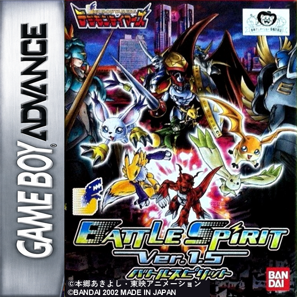
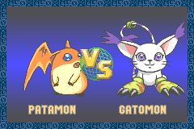
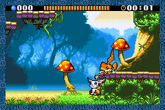
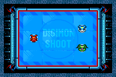

# Digimon Tamers: Battle Spirit Ver. 1.5

[English](#english) · [한국어](#한국어) · [Download the v1.0.1 patch / 패치 다운로드](https://github.com/GimoXagros/gba-dbs1.5-porting/releases/tag/v1.0.1)

| Patamon vs. Gatomon · 파닥몬 대 가트몬 | Link battle · 통신 대전 | Digimon Shoot · 디지몬 슈트 |
| :---: | :---: | :---: |
|  |  |  |

## English

This fan port brings the WonderSwan Color edition of *Battle Spirit Ver. 1.5* to Game Boy Advance. Choose from 15 fighters, meet Calumon to evolve during a match, or open Collection after unlocking it to play seven rounds of Digimon Shoot. The menus support English, Japanese, Korean and Digicode.

### Apply the patch

1. Download **DBS15-GBA-v1.0.1.bps** from the release above. Start with your own clean 4 MiB copy of *Digimon – Battle Spirit (USA)*. Back up your save.
2. In Floating IPS, choose **Apply Patch**, select the BPS and your USA game, then save the result as a new GBA file. The patched game is 16 MiB.
3. Open **OPTIONS** to choose a language. For solo play, you can also fix your D-Spirit count between 0 and 999 or set boss HP to 1. Both assists are off by default.

### Play a link match

Open **2P BATTLE**. Against the original USA game, choose **VS VER B•S** on the port. For the expanded roster and Tamer Tag rewards, run the port on both sides and choose **VS VER1.5** on each. Give each player a separate save file.

Link play was tested with two emulator cores, including wins, losses, rematches and reloading both saves. The campaign test used the in-game assists. A full unassisted run and physical link-cable testing remain post-release checks. [Patch guide](records/release-v1-guide.md) · [v1.0.1 fixes](records/issue4-fixes.md) / [v1.0.0 QA notes](records/v1-release.md)

## 한국어

원더스완 컬러(WSC)판 *배틀 스피릿 Ver. 1.5*를 게임보이 어드밴스(GBA)로 옮긴 팬 포팅판입니다. 15명의 디지몬 중 하나를 골라 싸우고, 대전 중 동글몬을 만나면 진화할 수 있습니다. 컬렉션을 해금하면 디지몬 슈트 7라운드에도 도전할 수 있습니다. 메뉴 언어는 영어·일본어·한국어·디지코드 중에서 고를 수 있습니다.

### 패치 적용하기

1. 위 릴리스에서 **DBS15-GBA-v1.0.1.bps**를 내려받으세요. 가지고 있는 *Digimon – Battle Spirit (USA)* 원본 파일(4 MiB)을 준비하고 기존 세이브를 백업하세요.
2. Floating IPS에서 **Apply Patch**를 누르고 BPS와 미국판 원본을 차례로 고르세요. 새 이름으로 저장하면 16 MiB GBA 파일이 만들어집니다.
3. **OPTIONS(설정)**에서 언어를 바꿀 수 있습니다. 혼자 플레이할 때는 전투 보조에서 D-스피릿을 0~999 중 원하는 값으로 고정하거나 보스 체력을 1로 설정할 수 있습니다. 처음에는 둘 다 꺼져 있습니다.

### 통신 대전하기

**친구와 대전(2P BATTLE)**으로 들어가세요. 상대가 기존 미국판을 사용한다면 포팅판에서 **배틀 스피릿과 대전(VS VER B•S)**을 고르세요. 두 사람 모두 포팅판이라면 양쪽에서 **Ver. 1.5와 대전(VS VER1.5)**을 골라야 추가 캐릭터와 테이머 태그 보상을 이용할 수 있습니다. 세이브 파일은 플레이어마다 따로 사용하세요.

에뮬레이터 두 대를 연결해 양쪽의 승패와 재대전, 저장 후 재시작을 확인했습니다. 캠페인은 게임 안의 전투 보조를 켜고 완주했습니다. 무보조 완주와 실물 GBA·링크 케이블 검수는 배포 후 진행할 항목입니다. [패치 적용 안내](records/release-v1-guide.md) · [v1.0.1 수정 내역](records/issue4-fixes.md) · [기능별 검수 기록](records/port-flow-release.md) · [이전 개발 기록](https://github.com/GimoXagros/gba-dbs1.5-porting/blob/v1.0.0/README.md)
