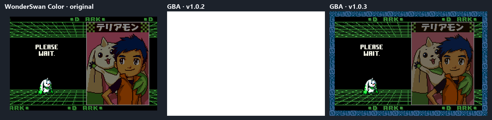

# D-ARK selection and return

On v1.0.2 the fourth main-menu row opened character selection. Confirming a settled fighter then produced a white screen on fresh and game-earned saves. The four language choices use the same scene transition. Collection → Tamer Tag follows its own route to mode 22.



All three screenshots follow a real selection of Terriermon. The WSC and v1.0.3 panels use the Japanese setting. The v1.0.2 panel contains 38,400 white pixels.

## Cause and correction

The WSC title sets configuration flag 2 for D-ARK. Confirming the fighter selects mode 18, whose initializer and constructor are `7B62:02EF` and `7B62:02F0`. Unmodified USA GBA ROM `996DE333…618ED` has twelve zero bytes in its corresponding callback row. The v1.0.2 port exposed the WSC title choice and kept that empty USA row. On the public patch applied to the USA ROM, the earned-save test entered mode 18 at frame 3873 and fell into mode 0 at 3874. The fresh-save test reached the same states at frames 3887 and 3888.

The fix registers mode 18 in the active GBA callback and transition tables. The selected fighter ID chooses the source fall, landing and idle events 7, 18 and 0. WSC starts at y=0 and lands at y=120. The GBA constructor reads the actor’s palette variant, the live 15-fighter portrait table and the existing four-language name-header table. Background graphics use the original stage grid, D ARK rails and waiting message. The Japanese WSC screen displays the English graphic **PLEASE WAIT**. The GBA restores that graphic in every language.

The original starts the wait controller after 70 source ticks. The GBA uses 56 ticks for its 60 Hz display. B plays the cancel cue and returns through mode 20 to the title. The GBA renderer keeps its tilemaps outside the native frame allocation and restores the previous display configuration on exit. This also preserves the ornamental border and the title on repeated visits.

## Peripheral boundary

On WSC the waiting task checks the communication task’s ready bit at `7B62:0618`. The WSC serial initializer at `4FFF:1504` enables the serial interface, and its receive handler reads bytes from port B1. The handshake validates the received data before setting the ready bit. Without a device the original stays in the waiting scene, A leaves it there, and B cancels. The GBA fix covers this disconnected path. Physical D-Ark communication, a successful accessory handshake and the subsequent accessory battle are outside the implemented scope. The fix writes no success packet or reward.

## Headless verification

Final integrated GBA SHA-256 is `8ABA49B14FFB4A1BABD3B99CD438846EA1D0CE7C0680F52D0B6F1A328A7CD508`. The WSC reference is `C415F227ED9A277F6553B4EC03CA16CE4D0058D1C1104889D90BD88071D76FD7`. The game-earned GBA input SaveRAM is `AE15A17E9B0B4C66EC85A19AA390069048A0D9B9B973CDC05FFACAE220995E5D`.

| Language | Fresh save | Earned save |
| --- | --- | --- |
| English | Guilmon, ID 0 | Gabumon, ID 9 |
| Japanese | Terriermon, ID 1 | Patamon, ID 13 |
| Korean | Renamon, ID 2 | Gatomon, ID 14 |
| Digicode | Veemon, ID 3 | Impmon, ID 11 |

Each run boots from a private copy, changes the language through Options, selects the fourth root row, confirms a fighter, waits, presses A, cancels with B, then re-enters and repeats. Independent GBA image checks cover all 233 lit pixels in the WSC waiting graphic, all 12,288 pixels in the dimmed portrait and localized name, all 6,144 ornamental border pixels, and 21,504 pixels of the returned title. Separate samples check the moving actor and rails. The core's 131,072-byte cartridge save domain is compared before entry and after return. The WSC reference repeats the same controller path without a device. No emulator memory writes or state loads are used.

All sixteen GBA visits and both WSC visits passed. Holding the waiting screen through an A press produced no transfer or reward. The GBA reached mode 20 on the 25th frame after B and the WSC on the 32nd. All sixteen GBA visits showed four or five distinct idle poses in the sampled interval. Each complete GBA SaveRAM file also matched the v1.0.2 control that used the same settings and canceled from character selection. The final local matrix is `build/dark-qa/final3/matrix.json`, SHA-256 `3032A8BA2AE164624A384B0F066E7FA80489008FEF3E6673FB26EABCF9FCEF0C`.

To repeat from the repository root, set `$gba`, `$wsc` and `$earned` to the corresponding local files and choose a fresh output directory.

```powershell
python tools/run_dark_wait.py --gba $gba --wsc $wsc --earned $earned --expected 8ABA49B14FFB4A1BABD3B99CD438846EA1D0CE7C0680F52D0B6F1A328A7CD508 --output build/d-ark-check
```
